# TwiPay user guide (development build)

A walkthrough of what the running app does today, with screenshots. Keep it in step with the app: when a screen changes,
recapture it ([scripts/review-harness](../../scripts/review-harness/README.md)) and update the text. Screenshots live in
[docs/screenshots](../screenshots/README.md); the same screenshots are shown as a web page at **`/guide`** in the customer UI. That page exists only in dev builds
(`VITE_TWIPAY_DEV_GUIDE=true`, set by `compose.stack.yaml`): `apps/customer-ui/scripts/sync-guide-images.mjs` copies the files listed in
`apps/customer-ui/src/routes/external-pages/guideData.ts` from `docs/screenshots/` into the git-ignored `public/guide/`, and removes it
when the flag is off. Edit captions in `guideData.ts`; never edit `public/guide/`.

All emails in the development build arrive in the floating inbox button (bottom-right of both apps).

## 1. Create an account
Open `/auth/signup`. Names, a valid email and a password of at least 12 characters are required; errors appear under the fields.
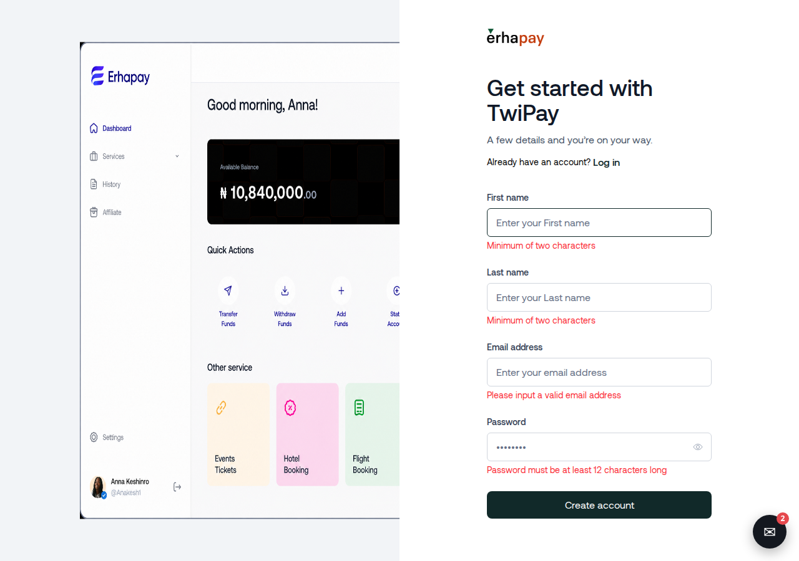

## 2. Verify your email
A six-digit code is sent to your email (dev inbox). A wrong code shows an error and clears the field.
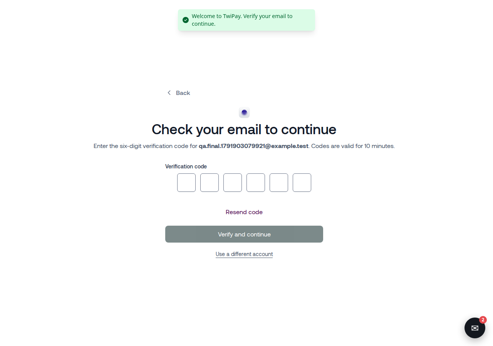
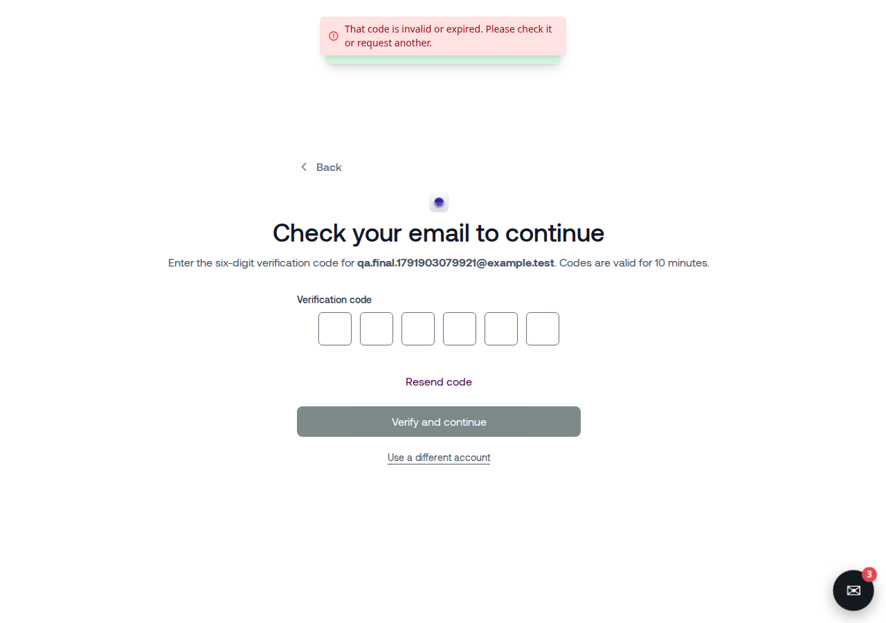

## 3. Dashboard
After verification you land on the dashboard.
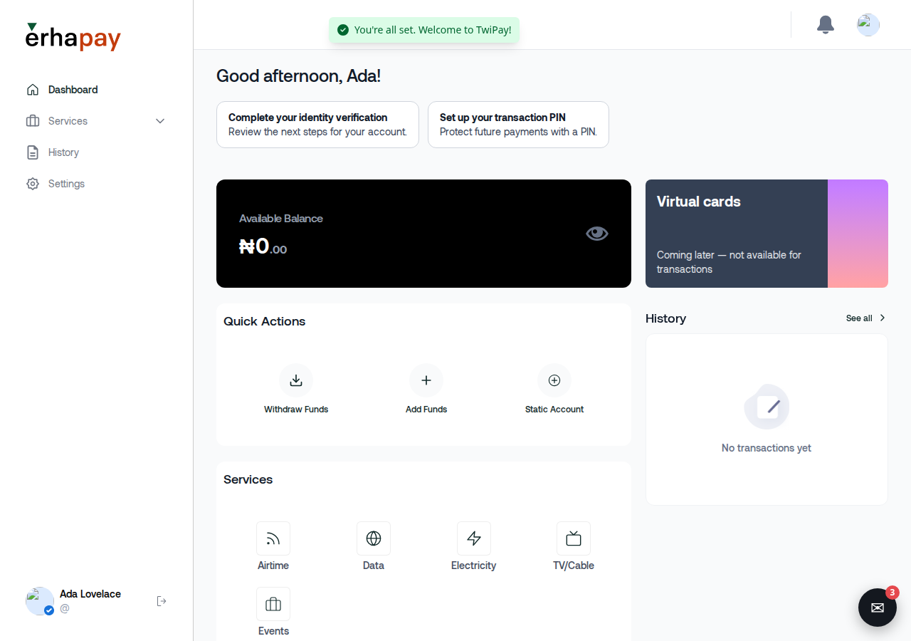

## 4. Sign in, and what happens when it goes wrong
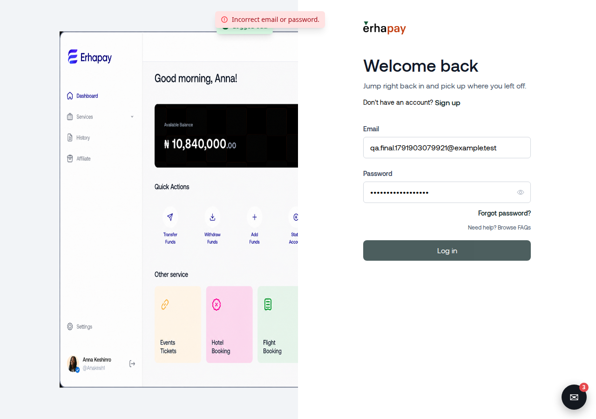
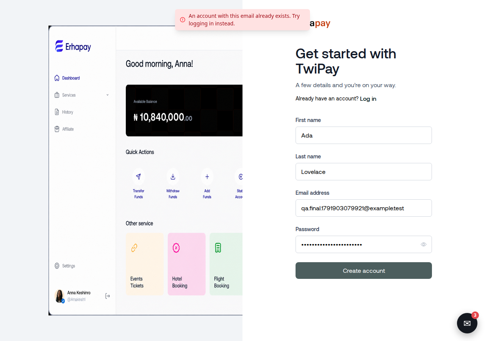
After ten attempts in a minute you are asked to wait.
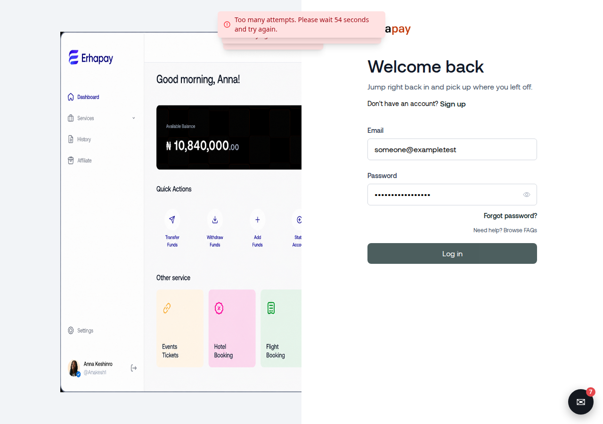

## 5. Reset a forgotten password
Enter your email, then the eight-digit code and a new password.
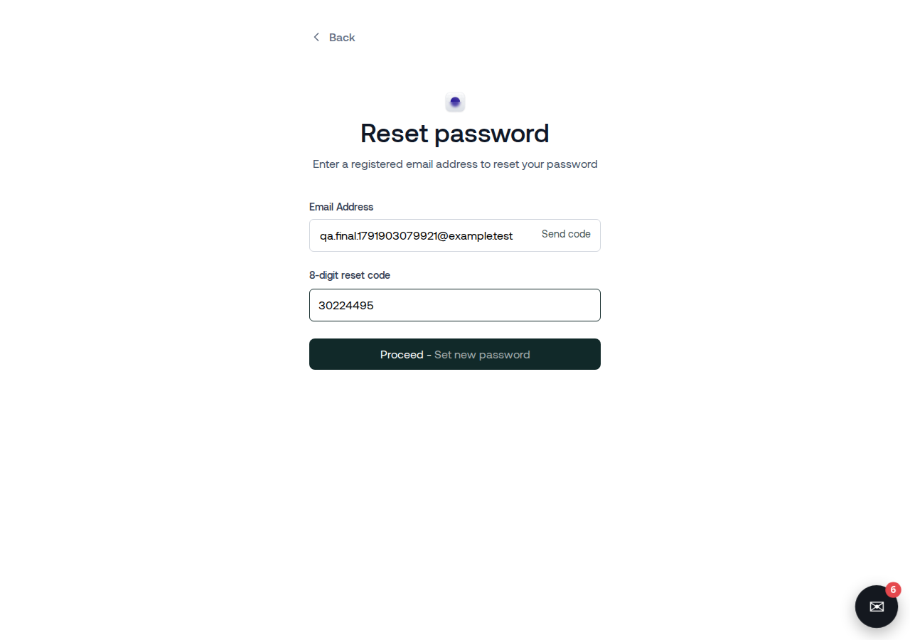
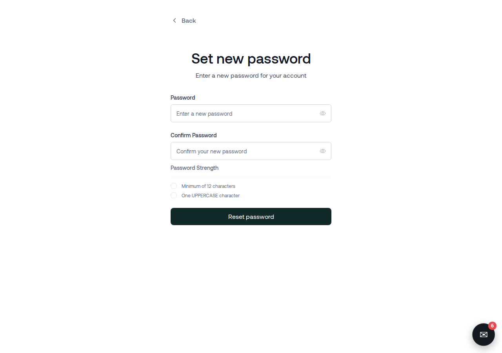
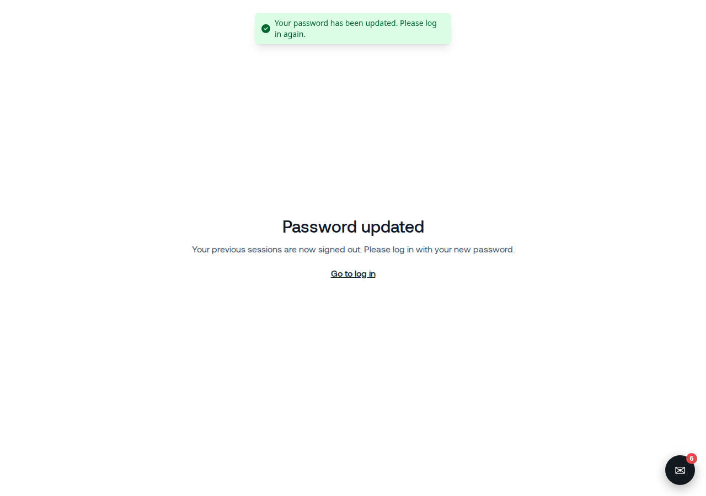

## 6. Admin console
Staff sign in at the admin app. The owner area also needs a verified email, the `SUPER_ADMIN` role and MFA.
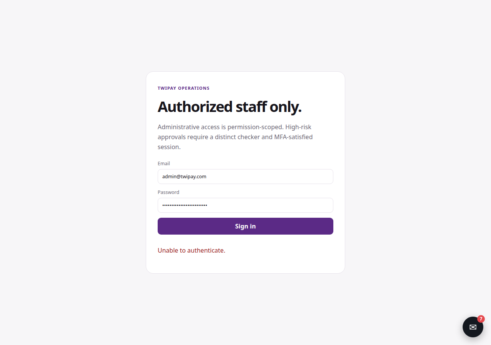
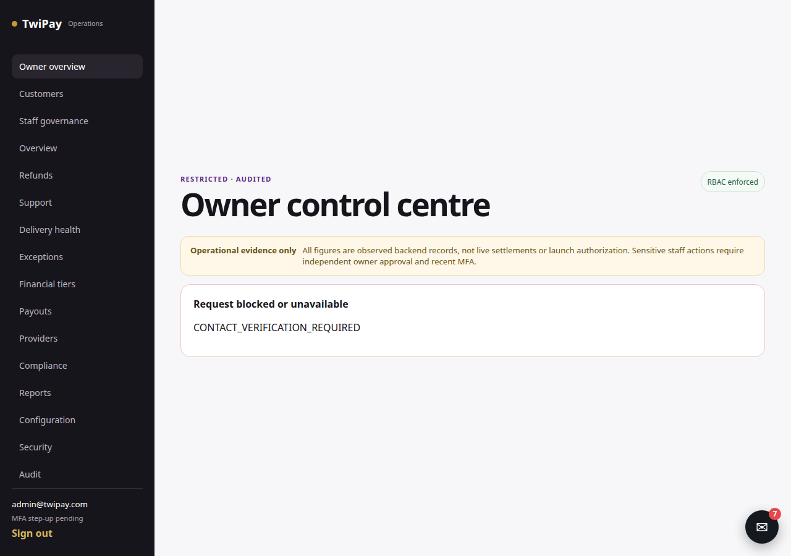

## 7. Development inbox
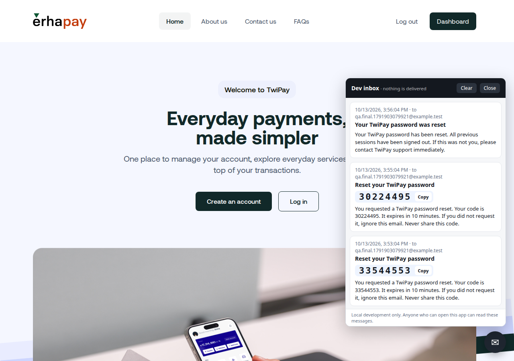

## 8. Every customer page
Full-page captures of all customer routes: [screenshots/2026-10-13-customer-routes](../screenshots/2026-10-13-customer-routes/ROUTES.md).
TODO (next agent): one section per dashboard area (wallet, services, settings, events, cards) with descriptions of each
button and popup, and the admin pages.
